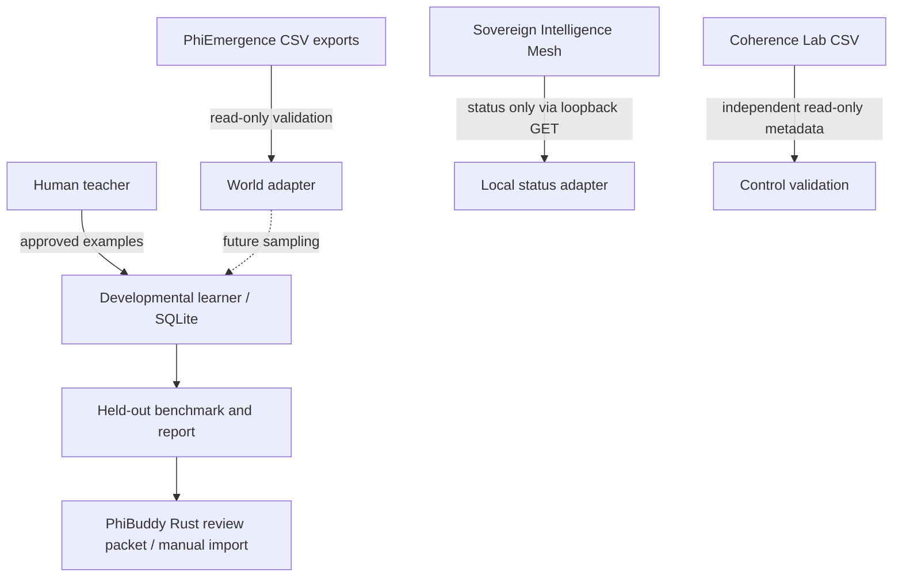

# Architecture and source boundaries

This is a **new research adapter**, not a merger of source repositories. External
projects stay independently versioned. Nothing here modifies another project.

## Integration status (v0.1)

- **Implemented:** bounded grow/prune learning, immutable evaluation paths, local
  SQLite persistence across restarts, protected teacher examples, bounded
  episodic recent sample store, cross-world replay, audit log,
  synthetic curriculum, held-out benchmark, HTML/JSON evidence and review packet.
- **Implemented read-only adapters:** Sovereign Mesh `GET /api/v1/status` on loopback;
  PhiBuddy Rust SQLite table counts; PhiEmergence v1.0 archive CSV structural
  validation; Coherence Lab CSV structural inspection.
- **NOT implemented:** direct LLM weight updates; automatic PhiBuddy orchestration;
  automatic training from conversations; live PhiEmergence event streaming;
  any claim of growth equivalent to living neurons or consciousness.

All local data stays on disk. No outgoing network call is made except an explicit
`mesh-status` command, which only contacts localhost. Review packets are files,
not messages automatically sent to another model.

## Proposed phase 2 (requires evidence)

1. Implement a gated, user-approved episode ingestion contract into the Mesh.
2. Link to a PhiEmergence event sampler with held-out world families.
3. Compare rehearsal, expansion and regularization on identical compute budgets.
4. Add forgetting/retention curves across 10+ seeds and independent worlds.
5. Introduce staged curricula and guard against benchmark memorization.
6. Invite PhiBuddy council analysis using explicit provenance and audit trails.

## Security

- Loopback-only optional Mesh status endpoint; no external URLs or credentials.
- No arbitrary tool execution, self-modification or autonomous source writes.
- Do not ingest personal chat logs as training data without explicit consent.
- No automatic model downloads, paid APIs, model activation, or GitHub pushes.
